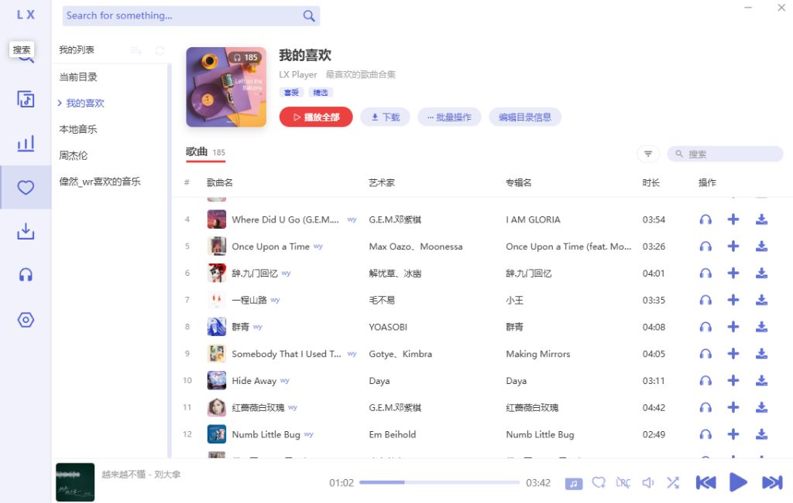
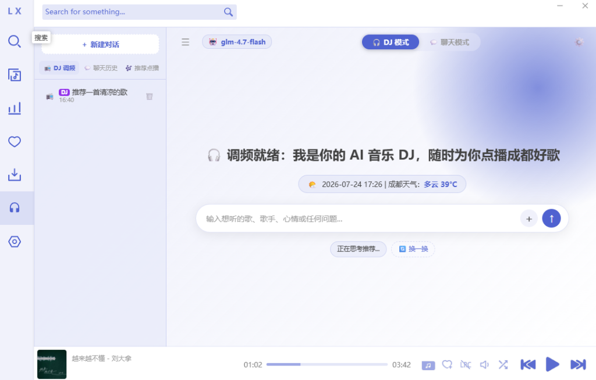

<h1 align="center">LX Music 桌面版</h1>

  
  
  
  
  <!--  -->
  
  <!--  -->

<!-- [![GitHub release][1]][2]
[![Build status][3]][4]
[![GitHub Releases Download][5]][6]
[![dev branch][7]][8]
[![GitHub license][9]][10] -->

<!-- [1]: https://img.shields.io/github/release/lyswhut/lx-music-desktop
[2]: https://github.com/lyswhut/lx-music-desktop/releases
[3]: https://ci.appveyor.com/api/projects/status/flrsqd5ymp8fnte5?svg=true
[4]: https://ci.appveyor.com/project/lyswhut/lx-music-desktop
[5]: https://img.shields.io/github/downloads/lyswhut/lx-music-desktop/latest/total
[5]: https://img.shields.io/github/downloads/lyswhut/lx-music-desktop/total
[6]: https://github.com/lyswhut/lx-music-desktop/releases
[7]: https://img.shields.io/github/package-json/v/lyswhut/lx-music-desktop/dev
[8]: https://github.com/lyswhut/lx-music-desktop/tree/dev
[9]: https://img.shields.io/github/license/lyswhut/lx-music-desktop
[10]: https://github.com/lyswhut/lx-music-desktop/blob/master/LICENSE -->

一个基于 Electron & Vue 开发的音乐软件

## 🚀 自定义修改版说明 (lx-music-desktop-style-change)

> **📦 当前版本号**：`v2.12.3-beta.11`

本仓库基于原版 [lx-music-desktop](https://github.com/lyswhut/lx-music-desktop) 进行个性化 UI 风格调整与功能增强。主要包含以下修改与更新：

### 🌟 主要修改内容

1. **🤖 AI 电台与智能播报 (✅ 功能已可用)**
   - 集成 AI DJ 交互界面与配置面板，支持接入通用 LLM 大模型及 TTS 语音合成服务。
   - 支持一键粘贴 cURL 命令快速解析生成 API 请求头及参数。
   - 支持天气、新闻等背景融入与音频流播放控制。
   - **架构解耦与组合式 API**：重组 AI DJ 界面逻辑为独立的 Vue 3 Composables（`useDjChat`、`useDjHistory`、`useDjWeather`），优化界面渲染性能与状态持久化。
   - **Prompt 模板引擎**：支持自定义提示词模板（包含动态系统变量替换与上下文渲染），可自由创建、编辑与切换不同人设模板。

2. **🎵 本地音乐与播放体验优化**
   - **0 延迟秒播**：重构播放逻辑，解除播放动作对底层数据库同步的硬依赖，实现秒级即播。
   - **优先匹配本地音源**：在线歌单与下载列表中播放歌曲时优先匹配本地已有音乐源。
   - **网易云风格歌单 Banner**：主页歌单详情页引入网易云风格 Header Banner、歌单标签及副标题编辑、缺失封面智能补全。
   - **播放自动下载**：支持播放歌曲时自动同步下载到本地。
   - **播放目录浮层**：播放目录弹窗支持队列清空与直接删除歌曲。

3. **🐛 稳定性与崩溃修复**
   - **首次启动播放列表加载修复**：修复应用首次启动时默认播放目录（播放列表）未能及时加载歌曲的问题。
   - **IPC 跨进程传输修复**：修复 Vue 3 `Proxy` 对象在 IPC 进程通讯传输时引发的 `An object could not be cloned` 报错（引入 `toRaw` 解包）。
   - **MediaSession 崩溃修复**：修复因极速切歌引发的 MediaSession `position > duration` 越界崩溃。
   - **UI 优化**：屏蔽本地音乐列表的误触下载按钮，修复列表相关渲染错误。

### 📦 发布文件与适配系统说明

- **Linux 便携程序（x86_64）**：`lx-music-desktop_2.12.3-beta.11_x64.AppImage`，赋予执行权限后运行。
- **Debian / Ubuntu 安装包（amd64）**：`lx-music-desktop_2.12.3-beta.11_amd64.deb`。
- 下载入口：[GitHub Releases](https://github.com/wei-ran233/lx-music-desktop-style-change/releases)。旧版 Windows 安装文件保留在对应历史版本中。

### ⚠️ 功能兼容性状态说明

- **AI 电台 (AI DJ)**：已可用（支持通用 LLM/TTS 及 Prompt 模板）。
- **数据同步服务 (Sync Service)**：还未适配。
- **开放 API 支持 (Open API)**：还未适配。

---

## AI 电台开发与模型接入

运行 `npm ci` 安装依赖，再运行 `npm run dev` 启动桌面开发环境。项目需要 Node.js 22 或更新版本；建议使用 npm 10 或更新版本。

在「AI 电台 → 设置 → 模型与 API」中选择服务商，填写 API Key 和模型名称，再点击「测试连接」。OpenAI 使用 Responses，Anthropic 使用 Messages，Google 使用 Gemini 协议；DeepSeek、Groq、通用兼容接口使用 Chat Completions，OpenRouter 根据模型目录选择协议。连接测试、动态建议与聊天均通过 [pi-ai 的 Models/Provider 接口](https://github.com/earendil-works/pi/blob/main/packages/ai/README.md)调用。

OpenCode Go 在「模型服务商」中选择。填写 API Key 后会自动读取服务端 `/models` 列表，也可点击「刷新模型」；支持搜索、点击选择、查看协议与推理标签，网络异常时保留内置目录。默认地址为 `https://opencode.ai/zen/go/v1`，默认模型为 `glm-5.2`；也支持官方的 `https://opencode.ai/inference/go/v1` 地址和 `opencode-go/<model-id>` 格式。在线新增的已知协议模型可直接使用，并会在重启后按需重新发现；缺少协议资料的模型会显示为「协议待确认」，避免猜测请求格式。Go 接入支持 Chat Completions、Responses、Messages 和 Gemini 协议。会话使用应用自身的标识，并在同一聊天的后续请求中保留 `x-opencode-session`。

电台页面会显示连接、思考、生成、搜歌、播放和语音准备等执行阶段，失败消息支持重试。右上角「播放队列」可以查看稍后播放与当前目录；推荐卡片支持「稍后播」。清空或移除待播项仅影响待播队列，不删除原歌单歌曲。服务地址、本地引擎探测与并发配置收纳在「高级连接设置」中。

Ollama 与 LM Studio 无需填写 API Key。可以使用本地探测选择已安装模型，也可以填写服务地址和模型名；本地 API 根地址自动补全 `/v1`。通用接口可以粘贴 API 根地址或完整的 `/chat/completions` 地址。自定义模型仍需具备所选协议要求的能力，音乐操作需要支持工具调用。

未配置远程模型时保留本地音乐推荐；已配置模型的请求失败会直接显示错误，便于检查配置。停止生成会中止后续工具执行。音乐工具的搜索结果直接生成卡片，工具执行结果回传模型后再继续生成回复。

运行 `npm run test:dj` 可启动仅监听回环地址的模拟模型服务，验证真实 SDK 的协议选择、流式响应、工具循环、错误与取消行为，无需真实 API Key。

### 对话、历史与服务进程

AI 电台支持多行输入：Enter 发送，Shift+Enter 换行，中文输入法确认不会误发送。模型回复支持经过 HTML 转义的 Markdown（标题、列表、代码、引用和 http/https 链接），原始 HTML 不执行。推理默认折叠；向上滚动阅读时暂停自动跟随，可以点击「回到最新消息」。

历史记录按本地日期分为今天、昨天、更早和日期未知，支持搜索标题、歌手与消息正文，支持重命名且后续回复不会覆盖用户标题。DJ 对话与普通聊天分别保存；旧记录保留，不确定日期的记录不会被错误归入今天。

模型列表、连接测试、流式生成和网络 TTS 请求由 Electron 主进程统一处理，支持取消、请求超时和窗口关闭时清理。音乐搜索与播放器工具仍由界面中的播放器模块执行。浏览器原生语音继续由界面播放。

密钥通过 Electron safeStorage 与系统密钥环加密后写入用户数据目录，浏览器设置仅保存引用；保存失败时原配置保留。Linux 的 basic_text 后端不视为安全加密；未提供系统加密时新密钥仅在本次会话保存，设置页会显示该状态。导出配置不包含密钥，导入到新设备后需重新填写。密钥输入框不回显已保存密钥，可以输入新值替换。

运行 `npm run test:dj` 会同时执行模型协议与对话体验检查，不使用真实付费模型 Key。

## 用户界面

### 1. 我的列表页面

### 2. AI电台页面

### 3. 主界面预览

## 贡献代码

本项目欢迎 PR，但为了 PR 能顺利合并，需要注意以下几点：

- 对于添加新功能的 PR，建议在提交 PR 前先创建 Issue 进行说明，以确认该功能是否确实需要。
- 对于修复 bug 的 PR，请提供修复前后的说明及重现方式。
- 对于其他类型的 PR，则适当附上说明。

贡献代码步骤：

1. 参照[源码使用方法](https://lyswhut.github.io/lx-music-doc/desktop/use-source-code)设置开发环境；
2. 克隆本仓库代码并切换至 `dev` 分支进行开发；
3. 提交 PR 至 `dev` 分支。

## 源码使用方法

请参阅：<https://lyswhut.github.io/lx-music-doc/desktop/use-source-code>

## 项目协议

本项目基于 [Apache License 2.0](https://github.com/lyswhut/lx-music-desktop/blob/master/LICENSE) 许可证发行，以下协议是对于 Apache License 2.0 的补充，如有冲突，以以下协议为准。

---

*词语约定：本协议中的“本项目”指 LX Music（洛雪音乐助手）桌面版项目；“使用者”指签署本协议的使用者；“官方音乐平台”指对本项目内置的包括酷我、酷狗、咪咕等音乐源的官方平台统称；“版权数据”指包括但不限于图像、音频、名字等在内的他人拥有所属版权的数据。*

### 一、数据来源

1.1 本项目的各官方平台在线数据来源原理是从其公开服务器中拉取数据（与未登录状态在官方平台 APP 获取的数据相同），经过对数据简单地筛选与合并后进行展示，因此本项目不对数据的合法性、准确性负责。

1.2 本项目本身没有获取某个音频数据的能力，本项目使用的在线音频数据来源来自软件设置内“自定义源”设置所选择的“源”返回的在线链接。例如播放某首歌，本项目所做的只是将希望播放的歌曲名、艺术家等信息传递给“源”，若“源”返回了一个链接，则本项目将认为这就是该歌曲的音频数据而进行使用，至于这是不是正确的音频数据本项目无法校验其准确性，所以使用本项目的过程中可能会出现希望播放的音频与实际播放的音频不对应或者无法播放的问题。

1.3 本项目的非官方平台数据（例如“我的列表”内列表）来自使用者本地系统或者使用者连接的同步服务，本项目不对这些数据的合法性、准确性负责。

### 二、版权数据

2.1 使用本项目的过程中可能会产生版权数据。对于这些版权数据，本项目不拥有它们的所有权。为了避免侵权，使用者务必在 **24 小时内** 清除使用本项目的过程中所产生的版权数据。

### 三、音乐平台别名

3.1 本项目内的官方音乐平台别名为本项目内对官方音乐平台的一个称呼，不包含恶意。如果官方音乐平台觉得不妥，可联系本项目更改或移除。

### 四、资源使用

4.1 本项目内使用的部分包括但不限于字体、图片等资源来源于互联网。如果出现侵权可联系本项目移除。

### 五、免责声明

5.1 由于使用本项目产生的包括由于本协议或由于使用或无法使用本项目而引起的任何性质的任何直接、间接、特殊、偶然或结果性损害（包括但不限于因商誉损失、停工、计算机故障或故障引起的损害赔偿，或任何及所有其他商业损害或损失）由使用者负责。

### 六、使用限制

6.1 本项目完全免费，且开源发布于 GitHub 面向全世界人用作对技术的学习交流。本项目不对项目内的技术可能存在违反当地法律法规的行为作保证。

6.2 **禁止在违反当地法律法规的情况下使用本项目。** 对于使用者在明知或不知当地法律法规不允许的情况下使用本项目所造成的任何违法违规行为由使用者承担，本项目不承担由此造成的任何直接、间接、特殊、偶然或结果性责任。

### 七、版权保护

7.1 音乐平台不易，请尊重版权，支持正版。

### 八、非商业性质

8.1 本项目仅用于对技术可行性的探索及研究，不接受任何商业（包括但不限于广告等）合作及捐赠。

### 九、接受协议

9.1 若你使用了本项目，即代表你接受本协议。

---

若对此有疑问请 mail to: lyswhut+qq.com (请将 `+` 替换为 `@`)
